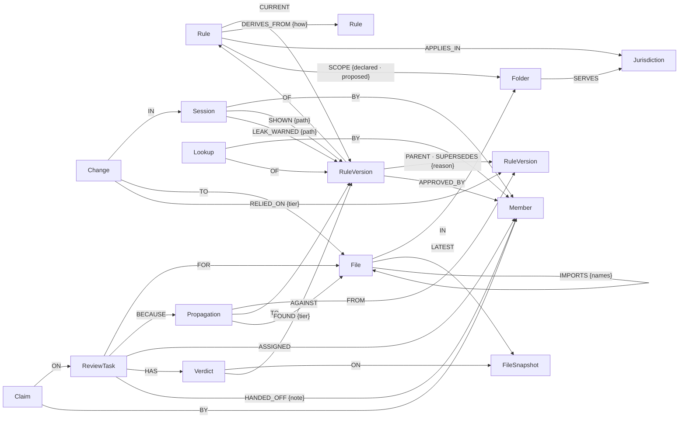

# Premise

**A shared memory for a team's AI coding agents that records which rule each piece of code was
written under, so that when a rule changes, every file written under the old version is found,
including files that never mention the rule, and handed to the right person's agent.**

The scenario is an invented Indian and US wallet company, *Tilldesk*, under RBI and FinCEN rules.
Premise supports evidence; it certifies nothing and is not legal or compliance advice.

[](https://youtu.be/MojUWR5jKDs)

**[Watch the demo on YouTube](https://youtu.be/MojUWR5jKDs)** (6:37): the problem, what FalkorDB is
and why a graph fits it, how Premise connects to Claude Code, one graph per team, speed, and the
measured results.

## What it is

AI agents write code *because of* a rule they were told: "cash loading is capped at ₹50,000 a
month". When the rule changes, someone updates the places they remember. The others keep the old
rule, often the ones that never name it, like an early-warning alert at `40_000_00` (80% of the
limit) in `src/admin/`.

Premise sits between the agents and the code:

1. **Before an edit**, an agent that opens a file is told the rules that govern it (a Claude Code
   hook), and an edit to a governed file is refused once until the agent has seen them.
2. **While writing**, the agent looks figures up with the `rule_lookup` MCP tool instead of
   remembering them. Each lookup is recorded against the file being written, wherever it lives.
3. **After the edit**, the change is stored with the exact rule versions it relied on, at one of
   four strengths: `asked` (looked up for this file), `shown` (shown before the edit), `in_scope`
   (in the rule's folders, but edited by hand or by a shell command), `session` (written in a
   session that looked the rule up for another file).
4. **When a rule is a draft**, a dry run shows every place that would change, with no tasks opened.
5. **When it becomes final**, Premise follows the graph from the old version to every file still
   written under it, opens a review task for the owner of each file, due on the effective date,
   and a Reviewer agent proposes for each file whether it really needs changing. It also checks
   every file whose latest content it holds for the old figure in any spelling, so a person's edit
   that no agent recorded is caught too (`mentions`), and Premise never finds less than `grep`
   would on the files it has seen.
6. **Every step is kept**, so the path behind any file can be shown: which session changed it,
   relying on which version of which rule, and what has happened since.

Around that core:

- **Rules built on rules.** An internal rule such as "alert at 80% of the cash limit"
  `DERIVES_FROM` the regulation; a change to the regulation also reaches code written under the
  derived rule, which never mentions the regulation.
- **Before changing a rule: what will it touch?** The Impact page counts the files each rule
  reaches, directly and through rules derived from it, and names the files that sit under several
  rules at once (`algo.WCC`), where fixing one rule can break another. The Why page draws the
  shortest connection from a file to each regulator (`algo.SPpaths`).
- **Audit evidence per rule:** every version, approver and reason, every AI change made under it
  (file, member, session, model, tier), every review and its resolution; as a page, JSON or CSV.
- **One-click fix, on a branch a person merges.** For each file the Reviewer says needs a change,
  it proposes line replacements against the copy it read, and Premise turns them into a real
  diff. `npx premise-fix <rule change>` puts them all on a new branch, `premise/<rule>-v<n>`, in a
  separate git worktree, so the developer's checkout and `main` are never touched; a fix whose file
  has changed since review does not apply and is listed instead. It never pushes or merges. The
  receipt page shows the command and offers the patch as a download.
- **Guessed figures, in one queue.** An agent that needs a figure nobody recorded writes it down as
  a draft with its source ("unverified: from memory") instead of typing it silently. The Guesses
  page lists each one with whose agent recorded it and every file already built on it, most relied
  on first. Compliance confirms it against a named source (the draft becomes final in place, with
  an `APPROVED_BY` edge) or corrects it, which is a rule change that opens a task for each of those
  files. The Tallyroll sessions left eight such figures, among them the EPF rate (12%), the EPS
  share (8.33%) and the FLSA overtime rate.
- **Handoffs:** a task passed to a teammate carries a note; their next session opens with it.
- **Team conventions too:** a repository's `.claude/rules/*.md` are imported as versioned rules,
  scoped by their `paths:`; when a rules file changes, code written under the old convention
  is found.

The agents in the demo are Claude Code sessions (developers' agents, through hooks and MCP) plus
Premise's own Reviewer agent (Claude Haiku 5.5). What every agent is told, and what it does next,
comes out of a graph query.

## What it remembers

| Kind of memory | Premise |
|---|---|
| Episodic memory | Sessions, changes, and what each agent was shown and asked for |
| Semantic memory | Rules, versioned, with citations, effective dates and markets |
| Procedural memory | Rules shown before every edit in scope; the standing instruction to look figures up |
| Persistent history | Every rule version, change, propagation and verdict; the why-path |
| Shared state and handoffs | Review tasks assigned to the owner's agent, claimed atomically, handed on with a note (an edge), opened at the next session |
| High-concurrency reads and writes | Every agent's file read and edit is a graph read or write ([measured](#measurements-and-what-lost)) |
| Separate memory per tenant | One graph per team, chosen by the caller's key; a cross-tenant test through every hook and MCP tool |

## Setup

Needs **Node 22** and **Docker**. From a fresh clone:

```bash
git clone https://github.com/siddheshsonawane07/premise && cd premise
npm ci
npm run db:up                               # FalkorDB falkordb/falkordb:v4.22.0, pinned
npx tsx scripts/setup-demo.ts --replay      # the Tilldesk demo graph, rebuilt from the captured sessions;
                                            # writes the demo members' keys to .env.demo.local (git-ignored)
PREMISE_WEB_MEMBER=tilldesk.chitra npm start
```

Open <http://localhost:8080>. **Run the demo** on Home (or *Take the tour* in the header) opens the team's demo rule with its form already filled in with the real change it was tested on (Tilldesk: the RBI cash-load cap, ₹50,000 → ₹10,000; Tallyroll: the EPF wage ceiling, ₹15,000 → ₹25,000). A nine-step walkthrough, drawn with Driver.js, then guides the visitor: preview the change, see the files that need a fix and those still fine, the one-command fix, one file traced to its regulator, and that same trace walked through as a graph, column by column (who changed the file, which rules it used and who made them, and the shortest path FalkorDB found). It starts only when asked: a first-time visitor gets a one-line offer on Home, which goes away for good once taken, declined or finished (kept in the browser's `localStorage`; `?tour=reset` on any page forgets that and starts the tour again). ×, Esc or *Skip tour* ends it at any step, and it works as a plain page without JavaScript. A preview assigns nothing, and the receipt shows the Reviewer's progress while it checks (about 25 seconds for Tallyroll's ten files). **Home** shows how Premise works as a four-step picture and what is waiting for you; **Rules** lists the official
rules with how many files each is built into, and changes one (a preview that assigns nothing, or,
as the compliance member Chitra, an official change that assigns a fix per file; money is typed in
₹ or $); the **receipt** that follows draws what the change found (the files built on the old version, split into those that need a fix and those still fine) and lists every file, the Reviewer's answer and the
one-click fix; **Guesses** holds the figures agents recorded from memory; **Tasks** the fixes to
make; **Why** the chain from a file to each regulator, in words and as the graph. The graph
algorithms (`algo.pageRank`, `algo.WCC`) are at <http://localhost:8080/impact>, left out of the
menu. The raw graph is in FalkorDB Browser at <http://localhost:3000>.

```bash
npm test                                    # 103 tests, against the real FalkorDB
npx tsx scripts/measure.ts                  # grep vs the rule's folders vs Premise, against an answer key
npx tsx scripts/measure.ts --payroll --rule us-flsa-salary  # the second test (setup-demo.ts --payroll --replay first)
npx tsx scripts/ablate.ts                   # what breaks without the graph (start the server first)
npx tsx scripts/import-rules.ts ../some-repo # a repo's .claude/rules/*.md as versioned rules
```

**The Reviewer** needs an Anthropic key: `cp .env.example .env` and set `ANTHROPIC_API_KEY`
(and `REVIEW_DAILY_CAP_USD`, default 1). Without it every verdict is `unknown`, and everything
else works.

**Connect your own agent.** Wire any repository to the server, then start Claude Code there with
a member's key:

```bash
node scripts/connect-repo.mjs ../some-repo http://localhost:8080   # writes .claude/settings.json and .mcp.json
set -a; . ./.env.demo.local; set +a
cd ../some-repo && PREMISE_KEY=$PREMISE_KEY_ASHA claude
```

The key is read from `PREMISE_KEY` at run time; it is never written into a file.

## The graph data model

One graph per team, `t_<teamId>`, plus `_control` for teams, members and hashed keys. Every node
key has a range index and a unique constraint, created at start-up and verified; the server
refuses to start if one is missing.



| Label | Properties that matter |
|---|---|
| `Rule` | `id`, `title`, `type`, `risk` |
| `RuleVersion` | `id` (`<rule>@<n>`), `n`, `text`, `figure` (smallest currency unit), `unit`, `citation`, `effective_from`, `status` (`draft`, `final`), and on a confirmed guess `verified_citation` |
| `Jurisdiction` | `code` (`IN`, `US`, and `TEAM` for a team's own conventions), `regulator` |
| `Folder`, `File` | `path`, always relative to the repo root |
| `Session` | `id` (Claude Code's session id), `tool`, `model`, `started_at` |
| `Lookup` | `path`, `at`: a member asked for a rule version while writing this path |
| `Change` | `id` (the tool call's id, so a retried hook records nothing twice), `diff`, `at` |
| `Propagation` | `dry_run`, `status`, and the receipt's counts as plain numbers |
| `ReviewTask` | `status` (`open`, `proposed_clear`, `resolved`), `tier`, `due`, `resolved_reason` |
| `Verdict` | `verdict` (`needs_change`, `still_fine`, `unknown`), `reason`, `patch`, `model`, `prompt_version` |
| `FileSnapshot` | `hash`, `content`: what the Reviewer reads |

**The core edge is `(Change)-[:RELIED_ON {tier}]->(RuleVersion)`**, written in the same query as
the change. Its tier is decided at edit time from what the graph holds: a `Lookup` by this member
for this path since the session began (`asked`), a `SHOWN` edge from this session for this path
(`shown`), the file merely being in scope (`in_scope`), or a lookup in this session for another
file, kept to the markets the file's folders serve (`session`). It is never recomputed.

**Why a graph.** The answer to "which code still follows the old rule, and who owns it?" is a
path: rule → the version that changed → the changes that relied on it → the files → the member
behind each file's latest change. The strongest link, an agent asking for the figure while editing
a file outside the rule's folders, exists only as an edge in the graph; no folder list, `grep` or
`git log` holds it. The graph also decides where a plain text match is wrong: ₹10,000 and $10,000
are both `10_000_00` in minor units, so a match in a file whose folders serve only another market
is dropped.

**Which file a borrowed figure lives in is also a path.** Each snapshot records the repo files it
imports from as `(File)-[:IMPORTS {names}]->(File)`, replaced whenever the content changes. When a
rule changes, the Reviewer follows up to three `IMPORTS` hops from each found file to the files that
still hold the old figure (`TEAM.importedSources`) and reads them too. A file that only uses an
imported constant, such as `topup.ts` → `limits.ts` or `reports/compliance.ts` →
`hr/onboarding.ts` → `in/epf.ts`, is then judged against the file that defines it instead of
blind.

**The same edges keep a figure in its one setting.** Before an agent's edit, Premise checks whether
the text it adds spells the current figure of a rule in the file's markets. If a file already
exports that figure as a constant, the one most imported (`TEAM.figureHome`), the edit is denied
once with the constant's name and the import line to use; the warning is a `LEAK_WARNED` edge, and
the same edit retried goes through, because the number may mean something else. Replaying the
captured sessions, it would have warned 10 times for the two rules that later changed; 9 of those
files are in the answer keys (Tilldesk's `cash-intake.ts`, which kept its own copy of the limit, and
eight tests that typed the boundary). The tenth was `test/esi.test.ts`, where ₹15,000 is an ESI
input, not the EPF ceiling.

## The Cypher queries

Every query is in [`src/db/queries.ts`](src/db/queries.ts), each with every value passed as a
parameter. All of them, with what each is for: [`docs/QUERIES.md`](docs/QUERIES.md). The ones the
product's claim rests on:

<!-- queries:start -->
#### `TEAM.rulesForPath`

Q5. The current rules governing a path: a SCOPE edge to the file or any folder above it, kept to the markets the path's folders serve (if any). For each, whether this session was already shown it for this path, and whether this member looked it up for this path since the session began. $pathsUp is the path itself followed by every folder above it.

```cypher
OPTIONAL MATCH (sf:Folder)-[:SERVES]->(sj:Jurisdiction)
WHERE sf.path IN $pathsUp
WITH collect(DISTINCT sj.code) AS served
OPTIONAL MATCH (sess:Session {id: $session})
WITH served, coalesce(sess.started_at, $fallbackSince) AS since
OPTIONAL MATCH (lastChange:Change)-[:TO]->(:File {path: $path})
WITH served, since, max(lastChange.at) AS lastEdit
MATCH (r:Rule)-[:SCOPE]->(s)
WHERE s.path IN $pathsUp
MATCH (r)-[:CURRENT]->(v:RuleVersion)
MATCH (r)-[:APPLIES_IN]->(j:Jurisdiction)
WITH DISTINCT served, since, lastEdit, r, v, j
WHERE size(served) = 0 OR j.code IN served OR j.code = 'TEAM'
OPTIONAL MATCH (:Session {id: $session})-[sh:SHOWN {path: $path}]->(v)
WITH since, lastEdit, r, v, j, count(sh) > 0 AS shown
OPTIONAL MATCH (:Member {id: $member})<-[:BY]-(lk:Lookup {path: $path})-[:OF]->(v)
WHERE lk.at >= since
WITH lastEdit, r, v, j, shown, count(lk) > 0 AS asked
OPTIONAL MATCH (v)-[:PARENT]->(prev:RuleVersion)
RETURN r.id AS ruleId, r.title AS title, r.risk AS risk, j.code AS jurisdiction,
       v.id AS versionId, v.n AS n, v.text AS text, v.figure AS figure, v.unit AS unit,
       v.citation AS citation, v.effective_from AS effectiveFrom, v.status AS status, v.at AS versionAt,
       prev.figure AS previousFigure, lastEdit, shown, asked
ORDER BY ruleId
```

#### `TEAM.recordLookup`

Q4b. Record that this member asked for this rule version while writing this path.

```cypher
MATCH (m:Member {id: $member})
MATCH (v:RuleVersion {id: $versionId})
CREATE (l:Lookup {id: $id, path: $path, at: $at})
CREATE (l)-[:BY]->(m)
CREATE (l)-[:OF]->(v)
RETURN l.id AS id
```

#### `TEAM.sessionLookups`

Rule versions this member looked up since the session began, for any file, with their market. An edited file that is not in such a rule's scope still relied on it at tier `session`: the agent had the figure in hand (real sessions copy it into tests written right after).

```cypher
MATCH (s:Session {id: $session})
MATCH (:Member {id: $member})<-[:BY]-(lk:Lookup)-[:OF]->(v:RuleVersion)
WHERE lk.at >= s.started_at
MATCH (r:Rule {id: v.rule_id})-[:APPLIES_IN]->(j:Jurisdiction)
RETURN DISTINCT v.id AS versionId, r.id AS ruleId, j.code AS jurisdiction
```

#### `TEAM.recordChange`

Q7. One edit, recorded in one query (STRICT 5.6): the Change, the session and file it belongs to, one RELIED_ON edge per rule version in scope at the tier decided from what was shown or asked, and any open review task this change resolves (it relied on the task's new version at tier `asked`). An unrelated edit, such as a typo fix, resolves nothing.

```cypher
MERGE (s:Session {id: $session})
ON CREATE SET s.tool = $tool, s.started_at = $at, s.branch = $branch
WITH s
MATCH (m:Member {id: $member})
MERGE (s)-[:BY]->(m)

FOREACH (link IN $chain |
  MERGE (c:Folder {path: link.child})
  MERGE (p:Folder {path: link.parent})
  MERGE (c)-[:IN]->(p))
MERGE (d:Folder {path: $dir})
MERGE (f:File {path: $path})
MERGE (f)-[:IN]->(d)
CREATE (ch:Change {id: $changeId, diff: $diff, at: $at, branch: $branch})
CREATE (ch)-[:IN]->(s)
CREATE (ch)-[:TO]->(f)
WITH ch, f
UNWIND $relied AS rel
MATCH (v:RuleVersion {id: rel.versionId})
CREATE (ch)-[:RELIED_ON {tier: rel.tier}]->(v)
WITH ch, f, v, rel
OPTIONAL MATCH (t:ReviewTask)-[:FOR]->(f), (t)-[:BECAUSE]->(:Propagation)-[:TO]->(v)
WHERE rel.tier = 'asked' AND t.status IN ['open', 'proposed_clear']
FOREACH (x IN CASE WHEN t IS NULL THEN [] ELSE [t] END |
  SET x.status = 'resolved', x.resolved_reason = $resolvedReason, x.resolved_at = $at)
RETURN count(DISTINCT t) AS resolved
```

#### `TEAM.supersede`

Q10. A rule changes, in one query (STRICT 5.6). The new version links to the current one by PARENT and SUPERSEDES {reason}, and a Propagation is queued from old to new. A final moves CURRENT and records who approved it; a draft leaves CURRENT where it is, so the propagation is a dry run.

```cypher
MATCH (r:Rule {id: $ruleId})-[cur:CURRENT]->(old:RuleVersion)
MATCH (sibling:RuleVersion {rule_id: $ruleId})
WITH r, cur, old, max(sibling.n) AS top
CREATE (v:RuleVersion {id: $ruleId + '@' + toString(top + 1), rule_id: $ruleId, n: top + 1,
                       text: $text, hash: $hash, at: $at, author: $author, citation: $citation,
                       effective_from: $effectiveFrom, status: $status})
SET v += $figure
CREATE (v)-[:OF]->(r)
CREATE (v)-[:PARENT]->(old)
CREATE (v)-[:SUPERSEDES {reason: $reason}]->(old)
CREATE (p:Propagation {id: $propagationId, rule_id: $ruleId, at: $at, dry_run: $dryRun, status: 'queued'})
CREATE (p)-[:FROM]->(old)
CREATE (p)-[:TO]->(v)
WITH r, cur, old, v, p
MATCH (author:Member {id: $author})
FOREACH (x IN CASE WHEN $dryRun THEN [] ELSE [cur] END | DELETE x)
FOREACH (x IN CASE WHEN $dryRun THEN [] ELSE [1] END |
  CREATE (r)-[:CURRENT]->(v)
  CREATE (v)-[:APPROVED_BY {at: $at}]->(author))
RETURN v.id AS versionId, old.id AS fromId, p.id AS propagationId
```

#### `TEAM.affectedFiles`

Q12. The core query. From the old version, back along RELIED_ON to every Change, and to its File. A file drops out if a later change relied on the new version at tier `asked` (it was fixed by someone who looked the new figure up), or if it already has a resolved task for the new version. For each file that stays: the strongest tier it was linked at, and the member behind its latest change, who receives the task.

```cypher
MATCH (:RuleVersion {id: $fromId})<-[rel:RELIED_ON]-(:Change)-[:TO]->(f:File)
WITH f, collect(rel.tier) AS tiers
OPTIONAL MATCH (f)<-[:TO]-(:Change)-[:RELIED_ON {tier: 'asked'}]->(fixed:RuleVersion {id: $toId})
WITH f, tiers, count(fixed) AS fixedByLookup
WHERE fixedByLookup = 0
OPTIONAL MATCH (t:ReviewTask {status: 'resolved'})-[:FOR]->(f), (t)-[:BECAUSE]->(:Propagation)-[:TO]->(:RuleVersion {id: $toId})
WITH f, tiers, count(t) AS resolved
WHERE resolved = 0
MATCH (f)<-[:TO]-(lc:Change)-[:IN]->(:Session)-[:BY]->(m:Member)
WITH f, tiers, lc, m
ORDER BY lc.at DESC
WITH f, tiers, collect(m.id)[0] AS ownerId, collect(m.name)[0] AS ownerName
RETURN f.path AS path, ownerId, ownerName,
       CASE WHEN 'asked' IN tiers THEN 'asked' WHEN 'shown' IN tiers THEN 'shown'
            WHEN 'in_scope' IN tiers THEN 'in_scope' ELSE 'session' END AS tier
ORDER BY path
```

#### `TEAM.affectedViaDerived`

Q12b. Rules built on the changed rule. An internal rule such as "alert at 80% of the cash limit" DERIVES_FROM the regulation, so when the regulation changes, code written under the derived rule is affected too, even though it never relied on the regulation itself. Follows DERIVES_FROM up to four hops, then back along RELIED_ON from each derived rule's current version to the files.

```cypher
MATCH (:Rule {id: $ruleId})<-[:DERIVES_FROM*1..4]-(d:Rule)-[:CURRENT]->(dv:RuleVersion)
MATCH (dv)<-[rel:RELIED_ON]-(:Change)-[:TO]->(f:File)
WITH f, collect(DISTINCT d.id) AS via, collect(rel.tier) AS tiers
OPTIONAL MATCH (t:ReviewTask {status: 'resolved'})-[:FOR]->(f), (t)-[:BECAUSE]->(:Propagation)-[:TO]->(:RuleVersion {id: $toId})
WITH f, via, tiers, count(t) AS resolved
WHERE resolved = 0
MATCH (f)<-[:TO]-(lc:Change)-[:IN]->(:Session)-[:BY]->(m:Member)
WITH f, via, tiers, lc, m
ORDER BY lc.at DESC
WITH f, via, tiers, collect(m.id)[0] AS ownerId, collect(m.name)[0] AS ownerName
RETURN f.path AS path, ownerId, ownerName, via,
       CASE WHEN 'asked' IN tiers THEN 'asked' WHEN 'shown' IN tiers THEN 'shown'
            WHEN 'in_scope' IN tiers THEN 'in_scope' ELSE 'session' END AS tier
ORDER BY path
```

#### `TEAM.importedSources`

Q8b. Where a figure this file borrows actually lives: follow IMPORTS up to three hops (a re-export in an index file is one hop) to files whose latest content contains one of the old figure's spellings. The Reviewer is shown those files, nearest first, so a file that only uses an imported constant is not judged blind. `terms` is a coarse CONTAINS; the caller checks whole numbers.

```cypher
MATCH p = (:File {path: $path})-[:IMPORTS*1..3]->(src:File)
MATCH (src)-[:LATEST]->(s:FileSnapshot)
WHERE any(t IN $terms WHERE s.content CONTAINS t)
WITH src, s, p
ORDER BY length(p)
WITH src, s, collect([n IN nodes(p) | n.path])[0] AS via, min(length(p)) AS hops
RETURN src.path AS path, s.content AS content, via, hops
ORDER BY hops, path
LIMIT 3
```

#### `TEAM.figureHome`

Q8d. A figure's home: the files whose latest content holds it, most imported first. The file that the most other files import the figure from is the one setting everyone should read; the caller then checks it really defines the figure as an exported constant.

```cypher
MATCH (f:File)-[:LATEST]->(s:FileSnapshot)
WHERE any(t IN $terms WHERE s.content CONTAINS t)
OPTIONAL MATCH (f)<-[i:IMPORTS]-(:File)
RETURN f.path AS path, s.content AS content, count(i) AS importers
ORDER BY importers DESC, path
LIMIT 5
```

#### `TEAM.openTask`

Q14. One review task per file and new version, in one query: created only if no open task already exists for that file and version, so running a propagation twice opens no duplicates.

```cypher
MATCH (p:Propagation {id: $propagationId})-[:TO]->(nv:RuleVersion)
MATCH (f:File {path: $path})
MATCH (m:Member {id: $assignee})
OPTIONAL MATCH (existing:ReviewTask)-[:FOR]->(f), (existing)-[:BECAUSE]->(:Propagation)-[:TO]->(nv)
WHERE existing.status IN ['open', 'proposed_clear']
WITH p, f, m, count(existing) AS already
WHERE already = 0
CREATE (t:ReviewTask {id: $taskId, status: $status, tier: $tier, due: $due})
CREATE (t)-[:FOR]->(f)
CREATE (t)-[:BECAUSE]->(p)
CREATE (t)-[:ASSIGNED]->(m)
RETURN t.id AS taskId
```

#### `TEAM.claimTask`

Q16. Claim a task, in one query: succeeds only if the task is still open and nobody holds a live claim. FalkorDB runs one graph's writes one at a time, so two claims cannot both win.

```cypher
MATCH (t:ReviewTask {id: $taskId})
WHERE t.status IN ['open', 'proposed_clear']
MATCH (m:Member {id: $member})
OPTIONAL MATCH (live:Claim)-[:ON]->(t)
WHERE live.expires_at > $now
WITH t, m, count(live) AS held
WHERE held = 0
CREATE (c:Claim {id: $claimId, expires_at: $expires})
CREATE (c)-[:ON]->(t)
CREATE (c)-[:BY]->(m)
RETURN c.id AS claimId
```

#### `TEAM.handOff`

Q17b. Hand a task to someone else, with a note, in one query: the ASSIGNED edge moves, the handoff is kept as an edge carrying the note (not a pasted summary), and any live claim on the task ends. The new owner's next session opens with the note.

```cypher
MATCH (t:ReviewTask {id: $taskId})-[a:ASSIGNED]->(prev:Member)
WHERE t.status IN ['open', 'proposed_clear']
MATCH (to:Member {id: $to})
OPTIONAL MATCH (c:Claim)-[:ON]->(t)
WHERE c.expires_at > $at
WITH t, a, prev, to, collect(c) AS claims
FOREACH (x IN claims | SET x.expires_at = $at)
DELETE a
CREATE (t)-[:ASSIGNED]->(to)
CREATE (t)-[:HANDED_OFF {note: $note, at: $at, from: prev.id, from_name: prev.name, by: $by}]->(to)
RETURN prev.name AS fromName, to.name AS toName
```

#### `TEAM.shortestToRegulators`

A1. The shortest connection from a file to each market's regulator, by FalkorDB's algo.SPpaths over the edges that carry meaning (an edit, what it relied on, which rule, what it is built on, where it applies). Folder membership is left out: a file sitting in a folder that serves India is not a reason.

```cypher
MATCH (f:File {path: $path})
MATCH (j:Jurisdiction)
CALL algo.SPpaths({sourceNode: f, targetNode: j, relTypes: ['TO', 'RELIED_ON', 'OF', 'DERIVES_FROM', 'APPLIES_IN'],
                   relDirection: 'both', maxLen: 8})
YIELD path, pathWeight
RETURN j.code AS jurisdiction, j.regulator AS regulator, pathWeight AS hops,
       [n IN nodes(path) | CASE labels(n)[0]
          WHEN 'File' THEN 'file:' + n.path
          WHEN 'Change' THEN 'change:' + n.id
          WHEN 'RuleVersion' THEN 'version:' + n.id
          WHEN 'Rule' THEN 'rule:' + n.id
          WHEN 'Jurisdiction' THEN 'jurisdiction:' + n.code
          ELSE labels(n)[0] END] AS ids,
       [n IN nodes(path) | labels(n)[0]] AS kinds,
       [n IN nodes(path) | CASE labels(n)[0] WHEN 'Change' THEN 'an edit' WHEN 'RuleVersion' THEN n.id
          ELSE coalesce(n.path, n.title, n.code) END] AS labels,
       [e IN relationships(path) | type(e)] AS rels
ORDER BY hops
```

#### `TEAM.rulePageRank`

A2. Foundational rules: algo.pageRank over DERIVES_FROM. A rule that other rules are built on ranks higher; changing it moves more than its own figure.

```cypher
CALL algo.pageRank('Rule', 'DERIVES_FROM')
YIELD node, score
RETURN node.id AS ruleId, score
ORDER BY score DESC
```

#### `TEAM.ruleClusters`

A4. Coupled rules: FalkorDB's algo.WCC over the code-to-rule graph. Rules land in one component when shared code ties them together, so a change to one can touch files written under another. (Betweenness was tried first: on this engine it follows edge direction only, so a file, which only receives edges, always scores 0.)

```cypher
CALL algo.WCC({nodeLabels: ['File', 'Change', 'RuleVersion', 'Rule'],
               relationshipTypes: ['TO', 'RELIED_ON', 'OF', 'DERIVES_FROM']})
YIELD node, componentId
WITH componentId, collect(CASE WHEN labels(node)[0] = 'Rule' THEN node.id END) AS rules,
     collect(CASE WHEN labels(node)[0] = 'File' THEN node.path END) AS files
WHERE size(rules) > 0
RETURN componentId, rules, size(files) AS files
ORDER BY size(rules) DESC
```
<!-- queries:end -->

## Live deployment

**Not deployed yet.** It will serve the Tilldesk graph, rebuilt from the captured sessions and
reset on a schedule, with the rule changes runnable from the browser.

## Demo video

**[youtu.be/MojUWR5jKDs](https://youtu.be/MojUWR5jKDs)**, 6 min 37 s. Chapters: 0:00 intro ·
0:05 the problem · 1:54 what is FalkorDB · 2:31 why a graph · 3:12 how Premise works · 3:47
connected to Claude Code · 4:27 many teams, one server · 4:55 speed and scale · 5:30 running it ·
5:51 the app · 6:14 results.

Every figure in it was re-run on 2026-10-29 and matched: the 103 tests, `measure.ts` for both
apps, `ablate.ts` and `load.ts`. The one exception is the Reviewer's "no false alarms", which is
from its 2026-10-17 run and needs an Anthropic key to repeat. The speed figures are from one
laptop, as the video says.

## What breaks without FalkorDB

`npx tsx scripts/ablate.ts`, first run on 2026-10-15, last on 2026-10-29:

- **Hooks off: the same rule change finds nothing.** With the graph's records, the dry run of the
  RBI draft (₹50,000 → ₹10,000) reports *"12 files were changed under the old version"* (10 on
  2026-10-15; the demo graph has grown since). Without
  them, the same rules, the same code: *"0 files were changed under the old version"*. The links
  exist only because the graph kept them.
- **FalkorDB stopped: agents cannot edit governed files**, and are told why. An agent's edit gets
  `deny: "Premise's memory (FalkorDB) is unreachable, so edits to files are blocked until it is
  back. Tell the user."`, within 0.6 s; `/healthz` answers `503`. Nothing falls back to another
  store, and nothing is cached outside the graph.

## Measurements and what lost

**Finding the files a rule change affects.** The answer key
([`demo/answer-key.json`](demo/answer-key.json)) was written by hand from the real Tilldesk code
([`demo/tilldesk`](demo/tilldesk)): 9 files must change if the India limit drops to ₹10,000.

| Method | Right | Missed | Flagged but fine |
|---|---|---|---|
| `grep` for the old figure in every spelling | 7 of 9 | both `40_000_00` literals in `src/admin/`: the alert and the weekly digest | — |
| The rule's declared folders | 2 of 9 | 7 files | 3 |
| **Premise**, before the Reviewer | **9 of 9** | — | `src/wallet/index.ts`, `receipt-email.ts`, `topup.ts` |
| **Premise, after the Reviewer** | **9 of 9** | — | — |

**What lost, and what changed because of it.**

- **`grep` did far better than we expected.** Real agents annotate the figures they write and copy
  them into tests, so it found 7 of 9. It misses only the two thresholds derived from the limit,
  which are the files that matter.
- **Premise first found only 5 of 7** (before the fifth session): two test files were written in the same session as a lookup
  but never looked up themselves. The fourth tier, `session`, was added to catch exactly that; it
  over-claims by design, and the Reviewer is there to clear what it over-claims.
- **Premise now also checks for the old figure** (the `mentions` tier), after we saw how well
  `grep` did. On this demo it adds nothing, because every file holding the figure was already
  linked through the graph; it is there for edits no agent made. Its first test run caught a
  false alarm of its own, a US file holding `10_000_00` (dollars, not rupees), and the market
  check above was added because of it.
- **The Reviewer (Claude Haiku 5.5) was first run on 2026-10-17**, against a version never
  written to the graph (`scripts/measure.ts --review`). Its first prompt left 2 of the 3 false
  alarms as "unknown": `index.ts` and `topup.ts` only use a constant from `limits.ts`, which it was
  not shown. Since it follows `IMPORTS` to the file that defines the figure, it clears all three
  and keeps all nine. `src/wallet/messages.ts` stays flagged as "unknown": the captured sessions
  never sent its content, so the Reviewer has nothing to read.

**A second test, fixed before it ran** ([`demo/payroll/PROTOCOL.md`](demo/payroll/PROTOCOL.md)).
The Tilldesk numbers come from an app, prompts and answer key made while Premise was being built,
and Premise changed after seeing them. So a second app was built under a protocol committed first:
- the app is *Tallyroll*, an invented payroll service, under three real rules;
- five fresh Claude Code sessions ran from prompts fixed in advance;
- the answer key was committed before anything was measured.

The changes measured are real ones:
- **India's EPF wage ceiling** rising from ₹15,000 to ₹25,000 (Union Cabinet, 16 September 2026);
- **the US overtime salary level** moving from $684 to $844 a week (the vacated 2024 rule).

| Change | `grep` | The rule's folders | Premise, before the Reviewer | Premise, after the Reviewer |
|---|---|---|---|---|
| EPF ₹15,000 → ₹25,000 (5 files) | **5 of 5**, 1 false alarm | 1 of 5 | **5 of 5**, 5 false alarms | **5 of 5**, 0 false alarms |
| FLSA $684 → $844 (4 files) | 1 of 4 | 1 of 4 | **4 of 4**, 2 false alarms | **4 of 4**, 0 false alarms |

No file in either key was cleared by the Reviewer. **All three tests change a figure, not a
calculation**; a change such as the Code on Wages' 50% rule, which alters how PF wages are worked
out, is not measured here.

- **On the EPF change, `grep` was as complete as Premise and more precise.** The agents wrote one
  constant per figure and imported it everywhere else. Premise's extra flags are the files that
  import it, which need no edit.
- **On the US change, `grep` missed three tests**, which write the figure as `dollars(684)` and as
  `35_568` ($684 × 52). Premise found them because the agents looked the rule up while writing them.

The run also found two real bugs, and each one restarted it from scratch:
1. **Premise told an agent "do not guess" for a figure it didn't hold, so the agent stopped.** Now
   the agent records the figure as a draft for compliance to confirm, and the file is linked to it.
2. **Premise's session-start instruction contradicted that fix.**

**The fixes, applied.** For the EPF change, the Reviewer's five proposed fixes were put on a branch
with `premise-fix` and Tallyroll's own tests run on it: **50 of 50 pass under ₹25,000**. Changing
only the setting (`EPF_WAGE_CEILING_PAISE` in `src/in/epf.ts`) leaves **6 tests in 4 files
failing**: the setting is one line of a five-file change. The Reviewer's first patches were prose
("Line 4: change it to …"), and none applied; it now returns line replacements, and Premise writes
the diff.

Across the five sessions, the agents recorded **eight figures Premise did not hold** (contribution
rates, rounding rules, the 40-hour week), each marked as coming from memory. Without Premise,
those eight would have been written into the code with no record.

**Load and latency**, on one machine (Apple silicon, FalkorDB in a 2-CPU Docker VM, server and
client on the same host), `npx tsx scripts/load.ts`, 2026-10-15:

| Measure | Result |
|---|---|
| Read hook (rules shown next to a file) | p50 3.3 ms, p95 3.9 ms |
| Edit guard (before an edit) | p50 2.9 ms, p95 3.4 ms |
| Recording edits, 20 concurrent writers for 15 s | 538 writes/s, p50 36.8 ms, p95 57.6 ms, 0 errors |
| Edits lost | 0 of 8,076 |
| Cross-tenant reads | 0 (test) |

Re-run on 2026-10-29: the same latencies (p95 3.9 ms and 3.4 ms), 543 writes/s, 0 of 8,140 edits
lost.

The design estimate is 10 developers × 34 AI commits a day ≈ 0.2 writes a second; ten times that
is 2.2. **These numbers are local; the deployed latency, with the network in between, is not
measured yet.**

## Honest limits

- **Shown is not used.** The `asked` tier and the Reviewer reduce this; nothing removes it.
- **Premise only checks files it has seen.** Content arrives when an agent reads or edits a file, or
  when the end-of-turn sweep sends a modified one. Code untouched since before Premise was installed
  is not checked for the old figure; run `grep` once when installing it.
- **Lookups depend on the agent following the instruction.** In the five captured sessions every
  agent did, unprompted; an agent that writes a figure from memory produces only weaker links.
- **An MCP call does not carry Claude Code's session id**, so a lookup is tied to the member, the
  file and the time since the session began, not to the session itself.
- **Scope is declared by people**, and the `session` tier over-claims. The receipt's tiers say how
  strong each link is.
- **A guessed figure is not checked against the official rules.** Matching a guess to a rule by
  title words flagged unrelated rules (EPF rounding against the EPF ceiling), so it was not built;
  no captured guess duplicates an official rule.
- **A fix is only as good as the Reviewer's edit**, and a person reviews the branch before merging.
  It was checked on one change (EPF: 50 of 50 Tallyroll tests pass on the branch).
- **The Reviewer can be wrong.** It proposes; a person confirms a clear, and every verdict carries
  its model and prompt version.
- **Claude Code only.** Cursor's hooks run commands only, cannot add context when a file is read,
  and imported Claude Code hooks fail open; `rule_lookup` works from any MCP client, but the
  guard and the recording do not.
- **FalkorDB v4.22.0:** with the append-only file on, a `SET` on a null from `OPTIONAL MATCH`
  crashes the server and every restart after it, so Premise persists with RDB snapshots and guards
  every such `SET`. Separately, the server segfaulted twice under the parallel test suite while a
  unique constraint was being created under concurrent queries, then hung in its crash memory test
  so it never restarted. Neither crash reproduced in isolation. Premise now creates schema with no
  other query in flight, the tests run one file at a time, and the crash memory test is off so a
  crash restarts the container.
- **`algo.betweenness` was tried and dropped:** on this engine it follows edge direction only, so a
  file, which only receives edges, always scores 0. `algo.WCC` answers the coupling question instead.
- **The captured sessions predate recording the model**, so their sessions show model `unknown`;
  new sessions record it.
- **One repository per team**, and paths are its keys.
- **The 2026 wallet limit is an RBI draft.** The demo's "final" is labelled as an assumption,
  with an assumed effective date. The US $30,000 threshold is a bill that has not been enacted.
- **Not compliance.** Premise is designed to support the change-management evidence regulators
  expect; it does not make anything compliant.

## AI disclosure

- **Claude Code (Claude Opus 5.5)** was used throughout: researching the regulations and
  prior art; drafting the product and plan documents; and writing the code, including the Cypher
  queries, the tests and the web view. Every commit it helped with carries a `Co-Authored-By`
  trailer.
- **Siddhesh decided** the product, the scenario (India and the US), the four tiers
  (including adding `session` after the measurement), what the Reviewer may and may not do, the
  stack, and what is not built; he reviews and can explain every query and choice.
- **The demo data was made by AI agents**: five headless Claude Code sessions, acting as the
  invented developers Asha and Ben, built Tilldesk through Premise from short task prompts that
  never mention Premise. Between the fourth and fifth, the compliance member's early-warning rule
  was recorded through the `record_rule` MCP tool. Their hook events were captured, scrubbed of local paths, and are
  replayed to build the demo graph ([`demo/events/tilldesk.jsonl`](demo/events/tilldesk.jsonl)).
  One file, `src/wallet/messages.ts`, was written by hand to show a hand edit being caught.
- **The demo video** was scripted and built with Claude Code, in Remotion; the narration is a
  local text-to-speech voice (Kokoro), and every figure in it was checked against the scripts
  above. Siddhesh chose what it says.
- **At run time, the Reviewer calls Claude Haiku 5.5** (`claude-haiku-5-5`). Nothing else calls a
  model: recording, lookups, propagation and the why-path are graph queries.

## Data

- **Tilldesk, its code and its people (Asha, Ben, Chitra) are invented.** No real company,
  customer or personal data.
- **Rule figures are public and cited** in each rule version:
  - ₹50,000 a month: RBI Master Direction on Prepaid Payment Instruments, 2021.
  - ₹10,000 a month: RBI draft Master Direction on PPIs, press release of 2026-04-22
    (<https://rbi.org.in/scripts/BS_PressReleaseDisplay.aspx?prid=62602>). A draft.
  - $10,000 a business day: 31 CFR 1010.311 (Bank Secrecy Act currency transaction reports).
  - $30,000: H.R. 1799 (STREAMLINE Act), not enacted; used only as a hypothetical draft.

## Credits

- **Ideas that shaped this one:** [Lineage](https://github.com/Vaibhaav-Tiwari/lineage) (a
  superseded decision propagated through documents and agent beliefs),
  [Axon](https://github.com/volfiros/axon-brain) (decisions linked to code by declared scope),
  [UndoGraph](https://github.com/Tejas-Sands/undograph) (repairing agent work after a source is
  corrected), GitHub Copilot Memory (repository facts checked against the code), Unsay and Lethe
  (changes that propagate through agent memory). Prior art: IBM's patent US10977156, linking
  compliance requirements to code by keywords, which is the `grep` column above.
- **Libraries:** [FalkorDB](https://github.com/FalkorDB/FalkorDB) (server, SSPL, run as a separate
  container), [`falkordb`](https://github.com/FalkorDB/falkordb-ts) client (MIT),
  `@modelcontextprotocol/server`, `/express`, `/node` (Apache-2.0), `express` (MIT), `zod` (MIT),
  `@anthropic-ai/sdk` (MIT), `cytoscape` (MIT), `driver.js` (MIT, the walkthrough's spotlight and popovers), the Anek Latin typeface by Ek Type (SIL Open Font License, loaded from Google Fonts), `tsx` (MIT), `vitest` (MIT), `typescript`
  (Apache-2.0).
