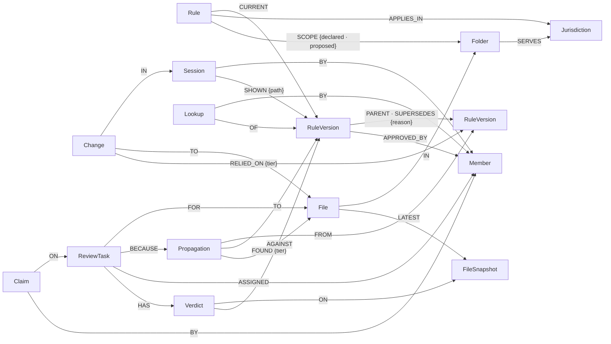

# Premise

**A shared memory for a team's AI coding agents that records which rule each piece of code was
written under, so that when a rule changes, every file written under the old version is found,
including files that never mention the rule, and handed to the right person's agent.**

Built for *Graph Hacks: Context for AI Agents* (WeMakeDevs × FalkorDB), 15–18 October 2026.
The scenario is an invented Indian and US wallet company, *Tilldesk*, under RBI and FinCEN rules.
Premise supports evidence; it certifies nothing and is not legal or compliance advice.

## What it is

AI agents write code *because of* a rule they were told: "cash loading is capped at ₹50,000 a
month". When the rule changes, someone updates the places they remember. The others keep the old
rule, often the ones that never name it, like an early-warning alert at `40_000_00` (80% of the
limit) in `src/admin/`.

Premise sits between the agents and the code:

1. **Before an edit**, an agent that opens a file is told the rules that govern it (a Claude Code
   hook), and an edit to a governed file is refused once until the agent has seen them.
2. **While writing**, the agent looks figures up with the `rule_lookup` MCP tool instead of
   remembering them. Each lookup is recorded against the file being written, wherever it lives.
3. **After the edit**, the change is stored with the exact rule versions it relied on, at one of
   four strengths: `asked` (looked up for this file), `shown` (shown before the edit), `in_scope`
   (in the rule's folders, but edited by hand or by a shell command), `session` (written in a
   session that looked the rule up for another file).
4. **When a rule is a draft**, a dry run shows every place that would change, with no tasks opened.
5. **When it becomes final**, Premise follows the graph from the old version to every file still
   written under it, opens a review task for the owner of each file, due on the effective date,
   and a Reviewer agent proposes for each file whether it really needs changing.
6. **Every step is kept**, so the path behind any file can be shown: which session changed it,
   relying on which version of which rule, and what has happened since.

The agents in the demo are Claude Code sessions (developers' agents, through hooks and MCP) plus
Premise's own Reviewer agent (Claude Haiku 5.5). What every agent is told, and what it does next,
comes out of a graph query.

## Track

**Track 2: Agent Memory and Coordination.**

| Track 2 asks for | Premise |
|---|---|
| Episodic memory | Sessions, changes, and what each agent was shown and asked for |
| Semantic memory | Rules, versioned, with citations, effective dates and markets |
| Procedural memory | Rules shown before every edit in scope; the standing instruction to look figures up |
| Persistent history | Every rule version, change, propagation and verdict; the why-path |
| Shared state and handoffs | Review tasks assigned to the owner's agent, claimed atomically, opened at their next session |
| High-concurrency reads and writes | Every agent's file read and edit is a graph read or write ([measured](#measurements-and-what-lost)) |
| Separate memory per tenant | One graph per team, chosen by the caller's key; a cross-tenant test |

## Setup

Needs **Node 22** and **Docker**. From a fresh clone:

```bash
git clone https://github.com/siddheshsonawane07/premise && cd premise
npm ci
npm run db:up                               # FalkorDB falkordb/falkordb:v4.22.0, pinned
npx tsx scripts/setup-demo.ts --replay      # the Tilldesk demo graph, rebuilt from the captured sessions;
                                            # writes the demo members' keys to .env.demo.local (git-ignored)
PREMISE_WEB_MEMBER=tilldesk.chitra npm start
```

Open <http://localhost:8080>: **Rules** (change a rule: a draft dry run, or as the compliance
member Chitra, a final change), **Receipt**, **Why** (the path, drawn) and **Tasks**.

```bash
npm test                                    # 47 tests, against the real FalkorDB
npx tsx scripts/measure.ts                  # grep vs the rule's folders vs Premise, against an answer key
npx tsx scripts/ablate.ts                   # what breaks without the graph (start the server first)
```

**The Reviewer** needs an Anthropic key: `cp .env.example .env` and set `ANTHROPIC_API_KEY`
(and `REVIEW_DAILY_CAP_USD`, default 1). Without it every verdict is `unknown`, and everything
else works.

**Connect your own agent.** Wire any repository to the server, then start Claude Code there with
a member's key:

```bash
node scripts/connect-repo.mjs ../some-repo http://localhost:8080   # writes .claude/settings.json and .mcp.json
set -a; . ./.env.demo.local; set +a
cd ../some-repo && PREMISE_KEY=$PREMISE_KEY_ASHA claude
```

The key is read from `PREMISE_KEY` at run time; it is never written into a file.

## The graph data model

One graph per team, `t_<teamId>`, plus `_control` for teams, members and hashed keys. Every node
key has a range index and a unique constraint, created at start-up and verified; the server
refuses to start if one is missing.



| Label | Properties that matter |
|---|---|
| `Rule` | `id`, `title`, `type`, `risk` |
| `RuleVersion` | `id` (`<rule>@<n>`), `n`, `text`, `figure` (smallest currency unit), `unit`, `citation`, `effective_from`, `status` (`draft`, `final`) |
| `Jurisdiction` | `code` (`IN`, `US`), `regulator` |
| `Folder`, `File` | `path`, always relative to the repo root |
| `Session` | `id` (Claude Code's session id), `tool`, `started_at` |
| `Lookup` | `path`, `at`: a member asked for a rule version while writing this path |
| `Change` | `id` (the tool call's id, so a retried hook records nothing twice), `diff`, `at` |
| `Propagation` | `dry_run`, `status`, and the receipt's counts as plain numbers |
| `ReviewTask` | `status` (`open`, `proposed_clear`, `resolved`), `tier`, `due`, `resolved_reason` |
| `Verdict` | `verdict` (`needs_change`, `still_fine`, `unknown`), `reason`, `patch`, `model`, `prompt_version` |
| `FileSnapshot` | `hash`, `content`: what the Reviewer reads |

**The core edge is `(Change)-[:RELIED_ON {tier}]->(RuleVersion)`**, written in the same query as
the change. Its tier is decided at edit time from what the graph holds: a `Lookup` by this member
for this path since the session began (`asked`), a `SHOWN` edge from this session for this path
(`shown`), the file merely being in scope (`in_scope`), or a lookup in this session for another
file, kept to the markets the file's folders serve (`session`). It is never recomputed.

**Why a graph.** The answer to "which code still follows the old rule, and who owns it?" is a
path: rule → the version that changed → the changes that relied on it → the files → the member
behind each file's latest change. The strongest link, an agent asking for the figure while editing
a file outside the rule's folders, exists only as an edge in the graph; no folder list, `grep` or
`git log` holds it.

## The Cypher queries

Every query is in [`src/db/queries.ts`](src/db/queries.ts), each with every value passed as a
parameter. All of them, with what each is for: [`docs/QUERIES.md`](docs/QUERIES.md). The ones the
product's claim rests on:

<!-- queries:start -->
#### `TEAM.rulesForPath`

Q5. The current rules governing a path: a SCOPE edge to the file or any folder above it, kept to the markets the path's folders serve (if any). For each, whether this session was already shown it for this path, and whether this member looked it up for this path since the session began. $pathsUp is the path itself followed by every folder above it.

```cypher
OPTIONAL MATCH (sf:Folder)-[:SERVES]->(sj:Jurisdiction)
WHERE sf.path IN $pathsUp
WITH collect(DISTINCT sj.code) AS served
OPTIONAL MATCH (sess:Session {id: $session})
WITH served, coalesce(sess.started_at, $fallbackSince) AS since
OPTIONAL MATCH (lastChange:Change)-[:TO]->(:File {path: $path})
WITH served, since, max(lastChange.at) AS lastEdit
MATCH (r:Rule)-[:SCOPE]->(s)
WHERE s.path IN $pathsUp
MATCH (r)-[:CURRENT]->(v:RuleVersion)
MATCH (r)-[:APPLIES_IN]->(j:Jurisdiction)
WITH DISTINCT served, since, lastEdit, r, v, j
WHERE size(served) = 0 OR j.code IN served
OPTIONAL MATCH (:Session {id: $session})-[sh:SHOWN {path: $path}]->(v)
WITH since, lastEdit, r, v, j, count(sh) > 0 AS shown
OPTIONAL MATCH (:Member {id: $member})<-[:BY]-(lk:Lookup {path: $path})-[:OF]->(v)
WHERE lk.at >= since
WITH lastEdit, r, v, j, shown, count(lk) > 0 AS asked
OPTIONAL MATCH (v)-[:PARENT]->(prev:RuleVersion)
RETURN r.id AS ruleId, r.title AS title, r.risk AS risk, j.code AS jurisdiction,
       v.id AS versionId, v.n AS n, v.text AS text, v.figure AS figure, v.unit AS unit,
       v.citation AS citation, v.effective_from AS effectiveFrom, v.status AS status, v.at AS versionAt,
       prev.figure AS previousFigure, lastEdit, shown, asked
ORDER BY ruleId
```

#### `TEAM.recordLookup`

Q4b. Record that this member asked for this rule version while writing this path.

```cypher
MATCH (m:Member {id: $member})
MATCH (v:RuleVersion {id: $versionId})
CREATE (l:Lookup {id: $id, path: $path, at: $at})
CREATE (l)-[:BY]->(m)
CREATE (l)-[:OF]->(v)
RETURN l.id AS id
```

#### `TEAM.sessionLookups`

Rule versions this member looked up since the session began, for any file, with their market. An edited file that is not in such a rule's scope still relied on it at tier `session`: the agent had the figure in hand (real sessions copy it into tests written right after).

```cypher
MATCH (s:Session {id: $session})
MATCH (:Member {id: $member})<-[:BY]-(lk:Lookup)-[:OF]->(v:RuleVersion)
WHERE lk.at >= s.started_at
MATCH (r:Rule {id: v.rule_id})-[:APPLIES_IN]->(j:Jurisdiction)
RETURN DISTINCT v.id AS versionId, r.id AS ruleId, j.code AS jurisdiction
```

#### `TEAM.recordChange`

Q7. One edit, recorded in one query (STRICT 5.6): the Change, the session and file it belongs to, one RELIED_ON edge per rule version in scope at the tier decided from what was shown or asked, and any open review task this change resolves (it relied on the task's new version at tier `asked`). An unrelated edit, such as a typo fix, resolves nothing.

```cypher
MERGE (s:Session {id: $session})
ON CREATE SET s.tool = $tool, s.started_at = $at, s.branch = $branch
WITH s
MATCH (m:Member {id: $member})
MERGE (s)-[:BY]->(m)

FOREACH (link IN $chain |
  MERGE (c:Folder {path: link.child})
  MERGE (p:Folder {path: link.parent})
  MERGE (c)-[:IN]->(p))
MERGE (d:Folder {path: $dir})
MERGE (f:File {path: $path})
MERGE (f)-[:IN]->(d)
CREATE (ch:Change {id: $changeId, diff: $diff, at: $at, branch: $branch})
CREATE (ch)-[:IN]->(s)
CREATE (ch)-[:TO]->(f)
WITH ch, f
UNWIND $relied AS rel
MATCH (v:RuleVersion {id: rel.versionId})
CREATE (ch)-[:RELIED_ON {tier: rel.tier}]->(v)
WITH ch, f, v, rel
OPTIONAL MATCH (t:ReviewTask)-[:FOR]->(f), (t)-[:BECAUSE]->(:Propagation)-[:TO]->(v)
WHERE rel.tier = 'asked' AND t.status IN ['open', 'proposed_clear']
FOREACH (x IN CASE WHEN t IS NULL THEN [] ELSE [t] END |
  SET x.status = 'resolved', x.resolved_reason = $resolvedReason, x.resolved_at = $at)
RETURN count(DISTINCT t) AS resolved
```

#### `TEAM.supersede`

Q10. A rule changes, in one query (STRICT 5.6). The new version links to the current one by PARENT and SUPERSEDES {reason}, and a Propagation is queued from old to new. A final moves CURRENT and records who approved it; a draft leaves CURRENT where it is, so the propagation is a dry run.

```cypher
MATCH (r:Rule {id: $ruleId})-[cur:CURRENT]->(old:RuleVersion)
MATCH (sibling:RuleVersion {rule_id: $ruleId})
WITH r, cur, old, max(sibling.n) AS top
CREATE (v:RuleVersion {id: $ruleId + '@' + toString(top + 1), rule_id: $ruleId, n: top + 1,
                       text: $text, hash: $hash, at: $at, author: $author, citation: $citation,
                       effective_from: $effectiveFrom, status: $status})
SET v += $figure
CREATE (v)-[:PARENT]->(old)
CREATE (v)-[:SUPERSEDES {reason: $reason}]->(old)
CREATE (p:Propagation {id: $propagationId, rule_id: $ruleId, at: $at, dry_run: $dryRun, status: 'queued'})
CREATE (p)-[:FROM]->(old)
CREATE (p)-[:TO]->(v)
WITH r, cur, old, v, p
MATCH (author:Member {id: $author})
FOREACH (x IN CASE WHEN $dryRun THEN [] ELSE [cur] END | DELETE x)
FOREACH (x IN CASE WHEN $dryRun THEN [] ELSE [1] END |
  CREATE (r)-[:CURRENT]->(v)
  CREATE (v)-[:APPROVED_BY {at: $at}]->(author))
RETURN v.id AS versionId, old.id AS fromId, p.id AS propagationId
```

#### `TEAM.affectedFiles`

Q12. The core query. From the old version, back along RELIED_ON to every Change, and to its File. A file drops out if a later change relied on the new version at tier `asked` (it was fixed by someone who looked the new figure up), or if it already has a resolved task for the new version. For each file that stays: the strongest tier it was linked at, and the member behind its latest change, who receives the task.

```cypher
MATCH (:RuleVersion {id: $fromId})<-[rel:RELIED_ON]-(:Change)-[:TO]->(f:File)
WITH f, collect(rel.tier) AS tiers
OPTIONAL MATCH (f)<-[:TO]-(:Change)-[:RELIED_ON {tier: 'asked'}]->(fixed:RuleVersion {id: $toId})
WITH f, tiers, count(fixed) AS fixedByLookup
WHERE fixedByLookup = 0
OPTIONAL MATCH (t:ReviewTask {status: 'resolved'})-[:FOR]->(f), (t)-[:BECAUSE]->(:Propagation)-[:TO]->(:RuleVersion {id: $toId})
WITH f, tiers, count(t) AS resolved
WHERE resolved = 0
MATCH (f)<-[:TO]-(lc:Change)-[:IN]->(:Session)-[:BY]->(m:Member)
WITH f, tiers, lc, m
ORDER BY lc.at DESC
WITH f, tiers, collect(m.id)[0] AS ownerId, collect(m.name)[0] AS ownerName
RETURN f.path AS path, ownerId, ownerName,
       CASE WHEN 'asked' IN tiers THEN 'asked' WHEN 'shown' IN tiers THEN 'shown'
            WHEN 'in_scope' IN tiers THEN 'in_scope' ELSE 'session' END AS tier
ORDER BY path
```

#### `TEAM.openTask`

Q14. One review task per file and new version, in one query: created only if no open task already exists for that file and version, so running a propagation twice opens no duplicates.

```cypher
MATCH (p:Propagation {id: $propagationId})-[:TO]->(nv:RuleVersion)
MATCH (f:File {path: $path})
MATCH (m:Member {id: $assignee})
OPTIONAL MATCH (existing:ReviewTask)-[:FOR]->(f), (existing)-[:BECAUSE]->(:Propagation)-[:TO]->(nv)
WHERE existing.status IN ['open', 'proposed_clear']
WITH p, f, m, count(existing) AS already
WHERE already = 0
CREATE (t:ReviewTask {id: $taskId, status: $status, tier: $tier, due: $due})
CREATE (t)-[:FOR]->(f)
CREATE (t)-[:BECAUSE]->(p)
CREATE (t)-[:ASSIGNED]->(m)
RETURN t.id AS taskId
```

#### `TEAM.claimTask`

Q16. Claim a task, in one query: succeeds only if the task is still open and nobody holds a live claim. FalkorDB runs one graph's writes one at a time, so two claims cannot both win.

```cypher
MATCH (t:ReviewTask {id: $taskId})
WHERE t.status IN ['open', 'proposed_clear']
MATCH (m:Member {id: $member})
OPTIONAL MATCH (live:Claim)-[:ON]->(t)
WHERE live.expires_at > $now
WITH t, m, count(live) AS held
WHERE held = 0
CREATE (c:Claim {id: $claimId, expires_at: $expires})
CREATE (c)-[:ON]->(t)
CREATE (c)-[:BY]->(m)
RETURN c.id AS claimId
```
<!-- queries:end -->

## Live deployment

**Not deployed yet.** It will serve the Tilldesk graph, rebuilt from the captured sessions and
reset on a schedule, with the rule changes runnable from the browser.

## Demo video

**Not recorded yet.**

## What breaks without FalkorDB

`npx tsx scripts/ablate.ts`, on 2026-10-15:

- **Hooks off: the same rule change finds nothing.** With the graph's records, the dry run of the
  RBI draft (₹50,000 → ₹10,000) reports *"10 files were changed under the old version"*. Without
  them, the same rules, the same code: *"0 files were changed under the old version"*. The links
  exist only because the graph kept them.
- **FalkorDB stopped: agents cannot edit governed files**, and are told why. An agent's edit gets
  `deny: "Premise's memory (FalkorDB) is unreachable, so edits to files are blocked until it is
  back. Tell the user."`, within 0.6 s; `/healthz` answers `503`. Nothing falls back to another
  store, and nothing is cached outside the graph.

## Measurements and what lost

**Finding the files a rule change affects.** The answer key
([`demo/answer-key.json`](demo/answer-key.json)) was written by hand from the real Tilldesk code
([`demo/tilldesk`](demo/tilldesk)): 7 files must change if the India limit drops to ₹10,000.

| Method | Right | Missed | Flagged but fine |
|---|---|---|---|
| `grep` for the old figure in every spelling | 6 of 7 | `src/admin/monthly-compliance.ts`, the `40_000_00` alert | — |
| The rule's declared folders | 2 of 7 | 5 files | 3 |
| **Premise**, before the Reviewer | **7 of 7** | — | `src/wallet/index.ts`, `receipt-email.ts`, `topup.ts` |

**What lost, and what changed because of it.**

- **`grep` did far better than we expected.** Real agents annotate the figures they write and copy
  them into tests, so it found 6 of 7. It misses only the alert, which is the file that matters.
- **Premise first found only 5 of 7**: two test files were written in the same session as a lookup
  but never looked up themselves. The fourth tier, `session`, was added to catch exactly that; it
  over-claims by design, and the Reviewer is there to clear what it over-claims.
- **The Reviewer has not yet been run against the model**, so whether it clears the three files
  that never use the figure is not yet measured.

**Load and latency**, on one machine (Apple silicon, FalkorDB in a 2-CPU Docker VM, server and
client on the same host), `npx tsx scripts/load.ts`, 2026-10-15:

| Measure | Result |
|---|---|
| Read hook (rules shown next to a file) | p50 3.3 ms, p95 3.9 ms |
| Edit guard (before an edit) | p50 2.9 ms, p95 3.4 ms |
| Recording edits, 20 concurrent writers for 15 s | 538 writes/s, p50 36.8 ms, p95 57.6 ms, 0 errors |
| Edits lost | 0 of 8,076 |
| Cross-tenant reads | 0 (test) |

The design estimate is 10 developers × 34 AI commits a day ≈ 0.2 writes a second; ten times that
is 2.2. **These numbers are local; the deployed latency, with the network in between, is not
measured yet.**

## Honest limits

- **Shown is not used.** The `asked` tier and the Reviewer reduce this; nothing removes it.
- **Lookups depend on the agent following the instruction.** In the four captured sessions every
  agent did, unprompted; an agent that writes a figure from memory produces only weaker links.
- **An MCP call does not carry Claude Code's session id**, so a lookup is tied to the member, the
  file and the time since the session began, not to the session itself.
- **Scope is declared by people**, and the `session` tier over-claims. The receipt's tiers say how
  strong each link is.
- **The Reviewer can be wrong.** It proposes; a person confirms a clear, and every verdict carries
  its model and prompt version.
- **Claude Code only.** Cursor's hooks run commands only, cannot add context when a file is read,
  and imported Claude Code hooks fail open; `rule_lookup` works from any MCP client, but the
  guard and the recording do not.
- **FalkorDB v4.22.0:** with the append-only file on, a `SET` on a null from `OPTIONAL MATCH`
  crashes the server and every restart after it, so Premise persists with RDB snapshots and guards
  every such `SET`. One unexplained segfault was also seen once in a parallel test run and did not
  reproduce in 80 stress rounds; the container restarts by itself.
- **One repository per team**, and paths are its keys.
- **The 2026 wallet limit is an RBI draft.** The demo's "final" is labelled as an assumption,
  with an assumed effective date. The US $30,000 threshold is a bill that has not been enacted.
- **Not compliance.** Premise is designed to support the change-management evidence regulators
  expect; it does not make anything compliant.

## AI disclosure

- **Claude Code (Claude Opus 5.5)** was used throughout: researching the hackathon, the rules and
  prior art; drafting the product and plan documents; and writing the code, including the Cypher
  queries, the tests and the web view. Every commit it helped with carries a `Co-Authored-By`
  trailer.
- **Siddhesh decided** the product, the track, the scenario (India and the US), the four tiers
  (including adding `session` after the measurement), what the Reviewer may and may not do, the
  stack, and what is not built; he reviews and can explain every query and choice.
- **The demo data was made by AI agents**: four headless Claude Code sessions, acting as the
  invented developers Asha and Ben, built Tilldesk through Premise from short task prompts that
  never mention Premise. Their hook events were captured, scrubbed of local paths, and are
  replayed to build the demo graph ([`demo/events/tilldesk.jsonl`](demo/events/tilldesk.jsonl)).
  One file, `src/wallet/messages.ts`, was written by hand to show a hand edit being caught.
- **At run time, the Reviewer calls Claude Haiku 5.5** (`claude-haiku-5-5`). Nothing else calls a
  model: recording, lookups, propagation and the why-path are graph queries.

## Data

- **Tilldesk, its code and its people (Asha, Ben, Chitra) are invented.** No real company,
  customer or personal data.
- **Rule figures are public and cited** in each rule version:
  - ₹50,000 a month: RBI Master Direction on Prepaid Payment Instruments, 2021.
  - ₹10,000 a month: RBI draft Master Direction on PPIs, press release of 2026-04-22
    (<https://rbi.org.in/scripts/BS_PressReleaseDisplay.aspx?prid=62602>). A draft.
  - $10,000 a business day: 31 CFR 1010.311 (Bank Secrecy Act currency transaction reports).
  - $30,000: H.R. 1799 (STREAMLINE Act), not enacted; used only as a hypothetical draft.

## Credits

- **Ideas that shaped this one:** [Lineage](https://github.com/Vaibhaav-Tiwari/lineage) (a
  superseded decision propagated through documents and agent beliefs),
  [Axon](https://github.com/volfiros/axon-brain) (decisions linked to code by declared scope),
  [UndoGraph](https://github.com/Tejas-Sands/undograph) (repairing agent work after a source is
  corrected), GitHub Copilot Memory (repository facts checked against the code), Unsay and Lethe
  (changes that propagate through agent memory). Prior art: IBM's patent US10977156, linking
  compliance requirements to code by keywords, which is the `grep` column above.
- **Libraries:** [FalkorDB](https://github.com/FalkorDB/FalkorDB) (server, SSPL, run as a separate
  container), [`falkordb`](https://github.com/FalkorDB/falkordb-ts) client (MIT),
  `@modelcontextprotocol/server`, `/express`, `/node` (Apache-2.0), `express` (MIT), `zod` (MIT),
  `@anthropic-ai/sdk` (MIT), `cytoscape` (MIT), `tsx` (MIT), `vitest` (MIT), `typescript`
  (Apache-2.0).
